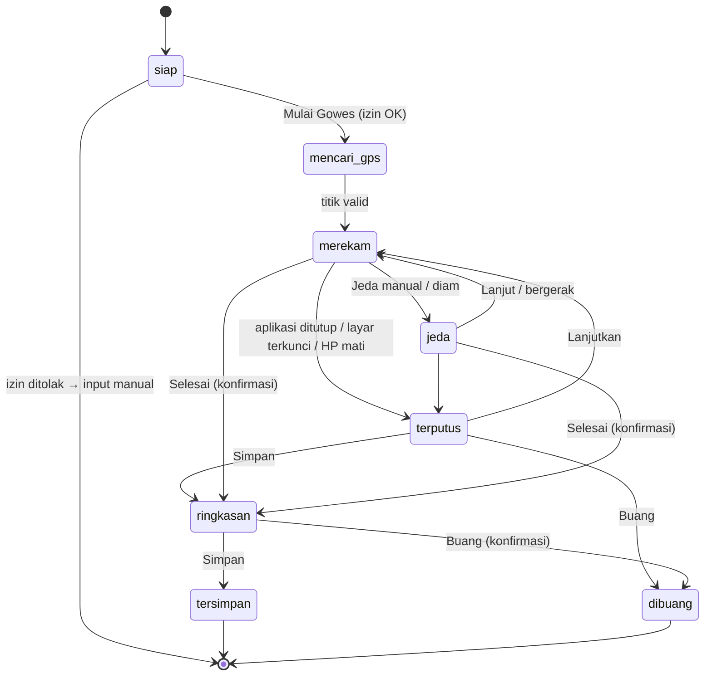

# WORKFLOW — GowesSehat

Status: Gate 4 disetujui (2026-11-16). Mengacu pada WF-01…WF-06 di `PRD.md`.

## 1. Alur utama

### WF-01 Rekam gowes (cyclocomp)
1. Beranda → **Mulai Gowes**.
2. Pertama kali: pengingat keselamatan sekali (`safetyNoticeSeen`).
3. Minta izin lokasi (PER-001). Ditolak → ERR-001: tawarkan **Catat manual**.
4. Layar Rekam terbuka; Wake Lock aktif (PER-002; gagal → ERR-007).
5. **Mencari GPS** sampai ada titik valid (akurasi ≤ 30 m) → mulai merekam (ERR-002).
6. Merekam: hitung jarak/waktu bergerak/elevasi; jeda otomatis saat berhenti; **Jeda** manual tersedia; titik disimpan berkala ke `active_recording`.
7. **Selesai** → konfirmasi → finalisasi (haluskan elevasi, hitung total) → layar ringkasan (peta jejak).
8. Tanya **jenis gowes** + **kondisi** (sekali) → **Simpan** → `rides` + `track_points`; hapus `active_recording`.
9. Opsi: Buang (dengan konfirmasi).
Cabang terputus: saat aplikasi dibuka dan `active_recording` ada → dialog **Lanjutkan / Simpan / Buang** (FR-139).
- *Lanjutkan*: kembali ke Layar Rekam (celah waktu dihitung sebagai jeda; tidak ada jarak lompat).
- *Simpan*: finalisasi dari titik yang ada → langkah 7–8.
- *Buang*: konfirmasi → hapus.

### WF-02 Catat manual
Beranda/Gowes → **Catat Gowes** (sheet) → isi form → validasi → (peringatan duplikat tidak memblokir) → **Simpan** → toast.

### WF-03 Harian
Tab **Harian**: jurnal (Hari ini/Kemarin) · hidrasi (+250/+500, koreksi) · checklist · mood · peregangan.
Kesiapan di Beranda dihitung ulang setiap perubahan.

### WF-04 Mingguan
Tab **Progres**: ringkasan minggu (pilih minggu) · catat berat/pinggang (disarankan mingguan).

### WF-05 Cadangan
Banner pengingat (≥ 14 hari atau ≥ 10 gowes baru sejak cadangan terakhir) → **Ekspor JSON** → file tersimpan di HP → `lastBackupAt` diperbarui. Pulih: **Impor JSON** → validasi → pratinjau → konfirmasi → tulis transaksi.

### WF-06 Ke Strava
Detail gowes rekaman → **Ekspor GPX** (opsi potong 200 m) → file → unggah manual lewat situs web Strava.

### WF-07 Pengingat
Lainnya → Pengingat → pilih jenis & jam → **Buat file kalender** → buka dengan Kalender HP.

## 2. Status transisi perekaman

Aturan: hanya satu perekaman aktif sekaligus. `terputus` bukan state yang dipilih pengguna; ia terdeteksi saat aplikasi dibuka lagi dan `active_recording.state` masih `merekam/jeda`.

## 3. Status tabel lain
Tidak ada status berlapis. Jurnal/hidrasi/tubuh/checklist hanya dibuat-diubah-dihapus (tanpa persetujuan/alur).

## 4. Penanganan galat (ringkas)
| Galat | Penanganan | Tampilan |
|---|---|---|
| ERR-001 izin lokasi ditolak | Tidak mulai; tawarkan input manual | Pesan + tombol **Catat manual** |
| ERR-002 GPS belum mengunci | Tunggu; batas waktu tunggu 60 dtk lalu saran pindah ke tempat terbuka | "Mencari sinyal GPS…" |
| ERR-003 sinyal GPS hilang | Tandai titik, jangan hitung garis lurus panjang | Indikator oranye |
| ERR-004 gagal menyimpan | Coba ulang; jangan buang; tawarkan ekspor | Peringatan merah + **Ekspor sekarang** |
| ERR-005 peta gagal | Rekaman jalan terus | "Peta tidak tersedia" |
| ERR-006 impor gagal | Data lama utuh | Alasan singkat |
| ERR-007 Wake Lock lepas | Coba minta lagi saat layar aktif | Peringatan |
| Pembaruan aplikasi saat merekam | Tidak muat ulang otomatis | Banner "Versi baru" muncul setelah selesai |

## 5. Keterlacakan
WF-01 → FR-130…147, AC-020…029 · WF-02 → FR-010…015, AC-002…004 · WF-05 → FR-120…122, AC-018/019 · WF-06 → FR-146, AC-027 · WF-07 → FR-110…112, AC-017.
